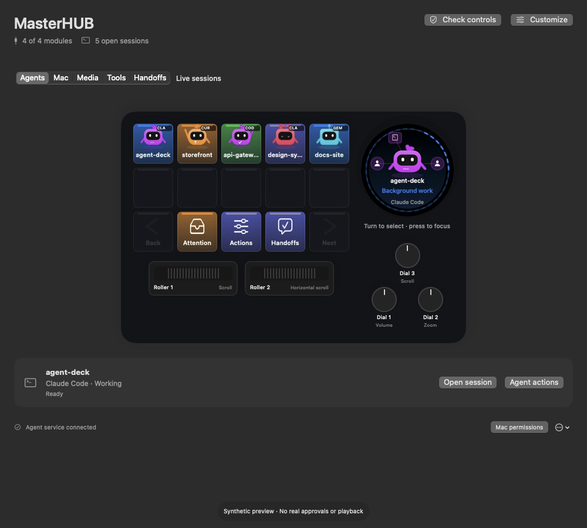

# Agent Deck

**Native macOS control deck for Cooler Master MasterHUB, built for AI coding agents.**

See which coding agents need you, focus the exact session, control Spotify, and keep Mac shortcuts on your desk—using MasterHUB's keys, dials, and rollers with no vendor driver needed.

Works with Claude Code, Codex, Cursor, and Gemini CLI / Antigravity (support level varies; see [status](#hardware-and-integration-status)).

**Development preview · macOS 14+ · Intel and Apple Silicon builds · MIT**



MasterHUB supports opt-in [application profiles](docs/MASTERHUB-PROFILES.md).
Named assignments switch with your active app while preserving the Default layout;
held controls, editing, and pending decisions defer a switch.
See [product ownership and migration stages](docs/PRODUCT-BOUNDARIES.md) for how Agent Deck separates hardware/agent controls from the separate Alfred assistant app.

## Your desk, five pages

- **Agents:** stable session tiles, exact-session focus, attention queue, and supported request-specific approvals.
- **Handoffs:** verified outcomes and input requests, with exact-session review.
- **Mac:** application launchers and shortcuts, customized in the native app.
- **Media:** Spotify playback, previous/next, shuffle/repeat, and system volume/mute.
- **Tools:** copy/paste, undo/redo, find/save, app switching, screenshot, and Spotlight.

An optional **Playful** theme adds four original project characters, configurable colors,
and a live dependency map on the round display. Shell/subagent waits stay Working.
See [the command-center guide](docs/PLAYFUL-COMMAND-CENTER.md).

Large symbols and vivid status colors keep the physical controls readable. The round
display shows the selected agent and its position. The app previews the same artwork.
Bounded activity animations respect Reduce Motion. Media shows Spotify playback
state and cached album artwork when local Automation access is available.

## Try it

Agent Deck is an open-source development preview. Build it from source below; prebuilt binaries will be published on GitHub Releases later. Candidate-specific physical checks remain
separate. See the [0.4.1 preview notes](docs/RELEASE-NOTES-0.4.1.md).

Contributors need Xcode with Swift support and Node 26. MasterHUB does **not** need a
vendor application, vendor SDK, .NET, or the legacy keypad plugin.

```sh
node scripts/build-native.mjs --universal --install
open "$HOME/Applications/Agent Deck.app"
```

Choose MasterHUB in setup, install the integrations you use, and follow the app's
permission guidance. Spotify controls use macOS Automation; shortcuts and agent focus
may need Accessibility. Device input may need Input Monitoring.

Maintainers: see [clean-commit release preparation](docs/RELEASE-AUTOMATION.md).

### Connect your AI subscriptions (legacy assistant)

Open **Supervisor → Open legacy assistant → Settings → Subscription connections**. Enable **Subscription only**
to block API billing routes, then use **Copy sign-in command** for Codex, Claude
Code, Gemini through Antigravity CLI (`agy`), or Cursor CLI. Finish each vendor's sign-in in Terminal and click
**Check sign-ins**. Agent Deck never asks contributors to paste OAuth tokens or
share a maintainer's credentials.

Each connection reports missing installation, required sign-in, verified sign-in,
or unavailable support separately. **Use as brain** selects a supported planning
adapter; installing or signing in does not prove model access or remaining quota.
Cursor and Gemini through Antigravity connect as supervised task agents. Their
planning brains stay unavailable until their CLIs can enforce Robin's no-tools
isolation requirements. Codex and Claude can also act as Robin's planning brain.
See the
[subscription guide](docs/SUPERVISOR.md#subscription-only-connections).

### No hardware? Explore the demo

```sh
native/.build/debug/AgentDeck --demo
```

You can also choose **Agent Deck → Explore MasterHUB Demo…**.

The isolated demo uses synthetic agents and requests. It does not connect devices,
start the agent service, install hooks, request permissions, or execute real actions.

## Hardware and integration status

| Surface | Evidence | Limits |
| --- | --- | --- |
| MasterHUB 15-key module | All 15 physical inputs observed | Action outcomes checked separately |
| Two rollers | Both directions on both rollers observed | Uses standard HID startup initialization |
| Three small dials | All nine rotation/press inputs observed | Configuration and target-app behavior vary |
| Round screen dial | Rotation/press observed; image writes verified | Visual review remains ongoing |
| Other keypad families | Experimental source integrations | Outside the MasterHUB preview package |

These observations cover the development rig, not every Mac. Intel builds are
cross-compiled; physical Intel certification remains outstanding.

Claude Code supports hook status and supported request-specific approvals. Codex
structured approvals require explicitly app-managed sessions. Cursor supports
workspace focus and companion-extension terminal routing. Gemini CLI provides hook
status. Antigravity remains experimental. Unsupported actions are shown explicitly;
the app never guesses approval keystrokes.

## Local by default

### Teach a voice supervisor (legacy assistant)

Open **Supervisor → Open legacy assistant** to talk through follow-up prompts, approve reusable lessons,
and launch supervised Codex, Claude, or Cursor CLI tasks. Review drafts first;
enable project autopilot when ready. Choose Cloud voice or Local voice, use guided
local setup, and compare the same sample in each mode. See the
[supervisor guide](docs/SUPERVISOR.md) for setup, limits, and validation.

Agent state stays on your Mac. Pending approval context stays in memory; bounded
session metadata/history uses local SQLite. Notifications are opt-in. Spotify is
controlled locally; planned album artwork may require fetching an artwork URL.
The optional supervisor stores conversation transcripts, lessons, and managed-task
history locally. Cloud mode sends conversation/task context and live voice to its
provider; Local mode uses on-device speech and a loopback model server.
See [security boundaries](SECURITY.md) and [native architecture](docs/NATIVE.md).

## Build with us

```sh
swift test --package-path native
node scripts/test-native.mjs
node --test daemon/*.test.mjs
```

Start with [contributing](CONTRIBUTING.md), [hardware details](docs/MASTERHUB.md),
[release gates](docs/RELEASING.md), and [roadmap](docs/ROADMAP.md).
See [credits](NOTICE.md). Legacy device setup is documented separately in
[the legacy guide](docs/LEGACY.md).

### Reproduce the showcase

`node scripts/render-showcase.mjs` creates five labeled synthetic screenshots and a
30-second UI walkthrough in `dist/showcase`. It needs a built native app, a graphical
Mac session, and FFmpeg. Use `--stills-only` to skip FFmpeg. These are fixture-based
UI assets, not a recording of physical hardware or real approvals.

Troubleshooting: [preview a content-free diagnostic report](docs/DIAGNOSTICS.md).

## Why Agent Deck

| | Agent Deck | Cooler Master's official software | OpenStreamHub / HubDeck |
| --- | --- | --- | --- |
| Platform | Native macOS app | Vendor app (see vendor for platforms) | Open-source protocol research / cross-platform tooling |
| Vendor app or driver required | No | Yes | No |
| AI coding agent status and approvals | Yes (per-agent support varies) | No | No |
| Source | MIT, in this repo | Closed | Open source (see their repos) |

This comparison is a summary of project goals, not a feature audit of other tools. Agent Deck is independent of Cooler Master.

## Supported hardware

Agent Deck talks to MasterHUB modules through native IOHID. IDs below come from [docs/MASTERHUB.md](docs/MASTERHUB.md).

| Module | USB ID (vendor:product) |
| --- | --- |
| 15-key keypad | `2516:01fe` |
| Two rollers | `2516:0204` |
| Three small dials | `2516:0202` |
| Round screen dial | `2516:0206` |

## Status and limitations

- Development preview. Build from source for now; signed releases on GitHub Releases are planned.
- Hardware observations cover the maintainer's rig, not every Mac. Intel builds are cross-compiled; physical Intel certification is outstanding.
- Only one app instance can own the deck. Firmware updates and network control of other Macs are out of scope.
- Agent support is uneven: Claude Code has hooks and request-specific approvals; Codex structured approvals need app-managed sessions; Cursor has workspace focus; Gemini CLI has hook status; Antigravity is experimental. Unsupported actions are shown, never guessed.
- Other keypad families are experimental and outside the MasterHUB preview package.

## Credits

Independent implementation informed by protocol research from [OpenStreamHub](https://github.com/goniszewski/OpenStreamHub) and [HubDeck](https://github.com/Przemotar/hubdeck), and by cooltek-sdk. No upstream source is vendored. Full list in [NOTICE.md](NOTICE.md). Cooler Master and MasterHUB belong to their owners; this is not an official Cooler Master product.

## Contributing and license

See [CONTRIBUTING.md](CONTRIBUTING.md), [CODE_OF_CONDUCT.md](CODE_OF_CONDUCT.md) and [SECURITY.md](SECURITY.md). Licensed under [MIT](LICENSE).
