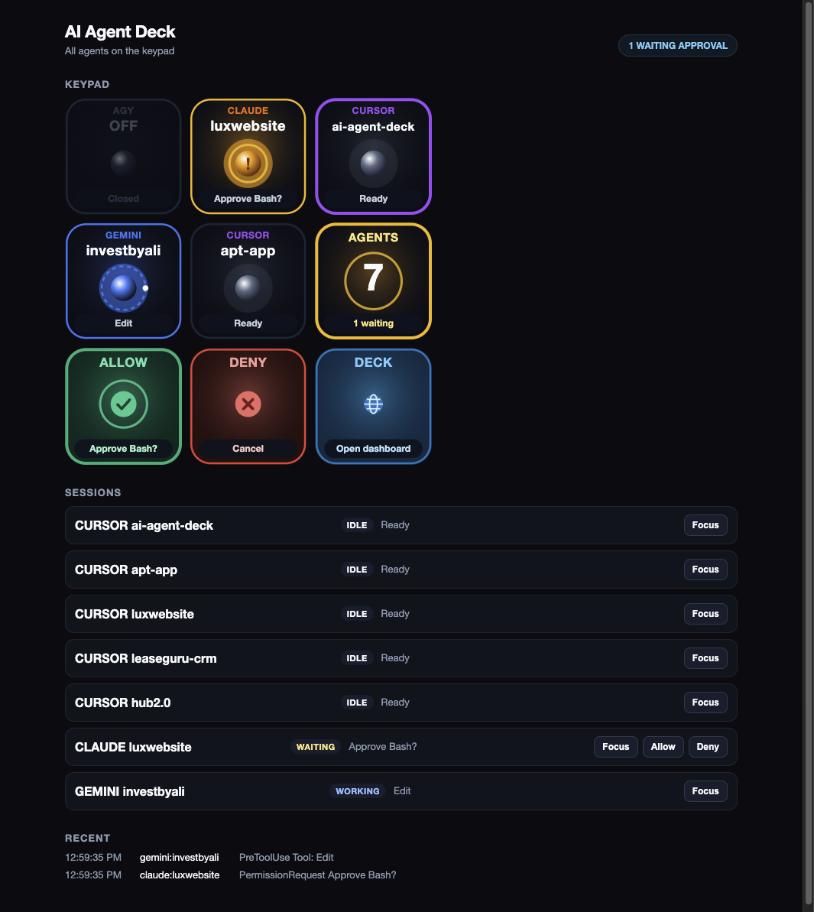

# AI Agent Deck

**Native Mac preview:** open `~/Applications/Agent Deck.app`. The SwiftUI app adds an attention inbox, paged keypads, stable session identities, request-specific Claude approvals, optional managed Codex sessions, and an editor terminal bridge. See [native setup, architecture, and release gates](NATIVE.md).

```sh
node scripts/build-native.mjs --universal --release --install
node scripts/verify-native-release.mjs
node scripts/install-native.mjs
```

The sections below describe the retained legacy service used during migration.

A 9-key status deck for the coding agents running on your Mac. It runs on a Logitech MX Creative Keypad and a Loupedeck / Razer Stream Controller, and the same view is in the browser at `http://127.0.0.1:19420`.



Agents it follows:

- Cursor, one tile per open window
- Claude Code
- Gemini CLI
- OpenAI Codex
- Antigravity

Tapping a project brings that app to the front. When an agent is waiting for approval, ALLOW and DENY light up. They stay dark the rest of the time, and they never type into a different agent. When only one agent is busy, the keypad switches to a single-agent layout: status, tool, workspace, focus, stop, grid, allow, deny, and the dashboard.

## Install

You need macOS, Node.js, the .NET SDK, and Logi Options+ or the Loupedeck app.

```bash
node scripts/build-and-deploy.mjs
node scripts/install.mjs
```

The installer wires the agent hooks, starts a launch agent named `com.ai-agent-deck.daemon`, and adds an "AI Agents" page to the keypad profile. It will not overwrite a config file it cannot parse. The first backup of each file is kept beside it as `.pre-agent-deck.bak`.

Then allow `node` to control other apps. System Settings → Privacy & Security:

1. Accessibility: turn on `node`. That is what reads Cursor's windows and types Allow, Deny, and Stop.
2. Automation: the first time a key focuses an app, allow `node` to control System Events and that app.

The daemon log is `~/Library/Logs/ai-agent-deck.log`.

## Uninstall

```bash
node scripts/install.mjs --uninstall
```

That removes the hooks, the launch agent, the plugin, and the keypad page. It leaves the `.pre-agent-deck.bak` backups in place.

## What a tile is telling you

| Look | Meaning |
| --- | --- |
| Colored orb, slow spin | The agent is working |
| Amber orb with ! | It is waiting for you |
| Green check | The turn finished |
| OFF | That agent is not running. The key does nothing |
| OFFLINE | The daemon is not running |

In Terminal and iTerm, ALLOW sends Return for Claude and Gemini, and `y` for Codex. DENY sends Escape. STOP sends Ctrl+C. The deck selects and verifies the terminal identity before sending a key. Cursor-hosted sessions support project-window focus; keyboard controls report an explicit error because Cursor does not expose an identifiable terminal tab to AppleScript.

## Troubleshooting

Keys say OFFLINE. The launch agent is not up. Run `node scripts/install.mjs` again, then check the log above.

Cursor says Closed and the dashboard names node. Turn on `node` under Accessibility. The next scan, about a second later, fills the tiles. No restart.

A project tile shows the wrong repo. The hook reports the folder it was started in. Start the agent from that project.

ALLOW stays dark for Cursor. Cursor's hooks do not say when it is waiting for approval.

A project press selects its matching Cursor window, including Claude or Codex running inside Cursor. Terminal and iTerm select the reported terminal tab. Other hosts require one exact project-window match; ambiguous or missing windows produce a visible error. New terminal sessions report their TTY automatically.

A press says the layout changed. The keypad sends the revision it displayed; a stale press is rejected so it cannot execute a different action. Press the updated key. Older plugins use a 0.8-second layout guard. Action failures appear briefly on the key and in full on the dashboard. The daemon logs both presses and results.

To rebuild the native helper and restart the daemon without modifying hooks or keypad profiles:

```bash
node scripts/install.mjs --runtime-only
```

The daemon keeps live session metadata in `~/Library/Caches/ai-agent-deck/sessions.json` across restarts and removes dead sessions during scanning.

## Develop

```bash
node daemon/server.mjs
node --test daemon/*.test.mjs
```

Status, layout, and the key artwork are in `daemon/`. The C# plugin only draws the SVG it is given and posts one press per tap.
